Министерство науки и высшего образования РФ

Федеральное государственное автономное образовательное учреждение высшего образования

**«СИБИРСКИЙ ФЕДЕРАЛЬНЫЙ УНИВЕРСИТЕТ»**

Институт космических и информационных технологий

Кафедра программной инженерии

---

# ОТЧЁТ №5

### по практической работе на тему «Синтаксический анализ контекстно-свободных языков»

*(Теория автоматов, языков и вычислений)*

---

Преподаватель — В. Н. Мымликов

Студент — Е. М. Прохорович, гр. КИ24-16/1Б

Красноярск 2026

<!-- pagebreak -->

## 1 Цель работы и постановка задачи

**Цель работы** — исследовать контекстно-свободные грамматики и алгоритмы синтаксического анализа контекстно-свободных языков.

**Вариант задания — № 7** во всех трёх частях согласно методическим указаниям к практической работе.

1. Построить в JFLAP LL(1)-грамматику оператора присваивания. Операнды выражения в правой части — даты двух форматов и однобуквенные переменные от `a` до `d`.
2. Реализовать методом рекурсивного спуска анализатор последовательности выражений с датами двух форматов, десятичными целыми числами и именами переменных из одной или двух букв. Доказать, что грамматика анализатора принадлежит классу LL(1).
3. Построить в JFLAP SLR(1)-грамматику последовательности операторов присваивания. Слева используется однобуквенная переменная от `a` до `d`, справа — выражение с датами, десятичными целыми числами и такими же переменными.

В порядке убывания приоритета используются унарный минус `-`, бинарные операции `+` и `*` **одного уровня** и присваивание `=`. Для операций одного уровня принят порядок слева направо. В LL(1)-грамматиках последовательность пар «операция, операнд» допускает такую группировку свёрткой слева. Цепочки присваиваний разбираются справа налево, например `a=b=c` означает `a=(b=c)`. Слева от каждого `=` стоит имя переменной.

Даты записываются в форматах `ДД.ММ.ГГГГ` и `ГГГГ/ММ/ДД`. Проверяется структура записи по количеству цифр и разделителям. Целое число состоит из одной или нескольких цифр, знак разбирается как унарная операция. Цифры и имена переменных записываются символами ASCII.

В моделях JFLAP для группировки используются `[` и `]`, цепочки вводятся слитно. В анализаторе на Python для группировки используются `(` и `)`. Пробельные символы между лексемами пропускаются. Во второй и третьей частях разделитель `;` ставится между элементами непустой последовательности.

LL(1)-анализатор строит левосторонний вывод. Он выбирает правило по вершине магазина и одному символу входа. SLR(1)-анализатор строит правосторонний вывод в обратном порядке. Сдвиги определяются переходами автомата LR(0), а свёртка по правилу `A → α` выполняется на символах из `FOLLOW(A)`.

## 2 Часть 1. LL(1)-грамматика

### 2.1 Построение грамматики

Начальный символ — `S`. Запись `ε` обозначает пустую цепочку.

```
S → V=R
R → VQ | HT
Q → =R | T
E → UT
T → +UT | *UT | ε
U → V | H
H → -U | [E] | W
W → DDJ
J → .DD.DDDD | DD/DD/DD
V → a | b | c | d
D → 0 | 1 | 2 | 3 | 4 | 5 | 6 | 7 | 8 | 9
```

`S` выводит оператор присваивания, а `R` — его правую часть. Если правая часть начинается с имени, после чтения имени `Q` различает вложенное присваивание по `=` и продолжение обычного выражения по `+`, `*` или концу входа. `E` выводит выражение в скобках, `T` — последовательность бинарных операций с операндами, `U` — один операнд. `H` объединяет варианты операнда, которые начинаются с минуса, открывающей скобки или цифры.

Оба формата даты имеют общий префикс из двух цифр `DD`. Он вынесен в правило `W → DDJ`. Следующий символ однозначно определяет формат. Точка выбирает `ДД.ММ.ГГГГ`, очередная цифра выбирает `ГГГГ/ММ/ДД`. Поэтому `W` выводит ровно даты двух указанных форматов.

Модель JFLAP — [LL1.jff](LL1.jff).

### 2.2 Множества FIRST, FOLLOW и таблица разбора

Ниже `digit` обозначает множество цифр от `0` до `9`, `var` — множество букв от `a` до `d`, а `$` — конец входа.

| Нетерминал | FIRST | FOLLOW |
| --- | --- | --- |
| `S` | `{var}` | `{$}` |
| `R` | `{-, [, digit, var}` | `{$}` |
| `Q` | `{*, +, =, ε}` | `{$}` |
| `E` | `{-, [, digit, var}` | `{]}` |
| `T` | `{*, +, ε}` | `{], $}` |
| `U` | `{-, [, digit, var}` | `{*, +, ], $}` |
| `H` | `{-, [, digit}` | `{*, +, ], $}` |
| `W` | `{digit}` | `{*, +, ], $}` |
| `J` | `{., digit}` | `{*, +, ], $}` |
| `V` | `{var}` | `{*, +, =, ], $}` |
| `D` | `{digit}` | `{*, +, ., /, ], digit, $}` |

Для каждой продукции `A → α` в таблицу вносятся символы из `FIRST(α) \ {ε}`. Если `α` выводит пустую цепочку, то также вносятся символы из `FOLLOW(A)`. В ячейках записаны правые части продукций. Столбец `digit` заменяет десять однотипных столбцов, а `var` — четыре. Записи `dᵢ` и `vᵢ` означают саму цифру или букву из соответствующего столбца. Прочерк означает ошибку.

| Нетерминал | `var` | `digit` | `=` | `-` | `+` | `*` | `[` | `]` | `.` | `/` | `$` |
| --- | --- | --- | --- | --- | --- | --- | --- | --- | --- | --- | --- |
| `S` | `V=R` | — | — | — | — | — | — | — | — | — | — |
| `R` | `VQ` | `HT` | — | `HT` | — | — | `HT` | — | — | — | — |
| `Q` | — | — | `=R` | — | `T` | `T` | — | — | — | — | `T` |
| `E` | `UT` | `UT` | — | `UT` | — | — | `UT` | — | — | — | — |
| `T` | — | — | — | — | `+UT` | `*UT` | — | `ε` | — | — | `ε` |
| `U` | `V` | `H` | — | `H` | — | — | `H` | — | — | — | — |
| `H` | — | `W` | — | `-U` | — | — | `[E]` | — | — | — | — |
| `W` | — | `DDJ` | — | — | — | — | — | — | — | — | — |
| `J` | — | `DD/DD/DD` | — | — | — | — | — | — | `.DD.DDDD` | — | — |
| `V` | `vᵢ` | — | — | — | — | — | — | — | — | — | — |
| `D` | — | `dᵢ` | — | — | — | — | — | — | — | — | — |

У `R`, `U`, `H`, `J`, `V` и `D` альтернативы начинаются с попарно непересекающихся множеств символов. Пустая альтернатива `T → ε` выбирается на `FOLLOW(T) = {], $}`, которое не пересекается с `{+, *}`. Для `Q → T` множество выбора равно `{+, *, $}`, для `Q → =R` — `{=}`. В каждой ячейке таблицы максимум одна продукция, следовательно, грамматика принадлежит классу LL(1).

### 2.3 Проверка LL(1)-анализатора и магазинного автомата

В JFLAP для `LL1.jff` выбрана команда **Input → Build LL(1) Parse Table**. Таблицу можно заполнить кнопкой **Do All**, затем открыть анализатор кнопкой **Parse**. Для каждой цепочки использованы кнопки **Start** и **Step** до сообщения о результате.

| № | Входная цепочка | Результат | Пояснение |
| --- | --- | --- | --- |
| 1 | `a=b` | `принята` | простое присваивание |
| 2 | `b=-[a+12.04.2026]*c` | `принята` | дата с точками, унарный минус и скобки |
| 3 | `d=c=2026/05/12` | `принята` | дата с косыми чертами и цепочка присваиваний |
| 4 | `a=123` | `отклонена` | целых констант в первом языке нет |
| 5 | `a=12.04.26` | `отклонена` | год должен состоять из четырёх цифр |
| 6 | `a=[b+c` | `отклонена` | отсутствует закрывающая скобка |

**Пример 1.** `a=b` — принята.

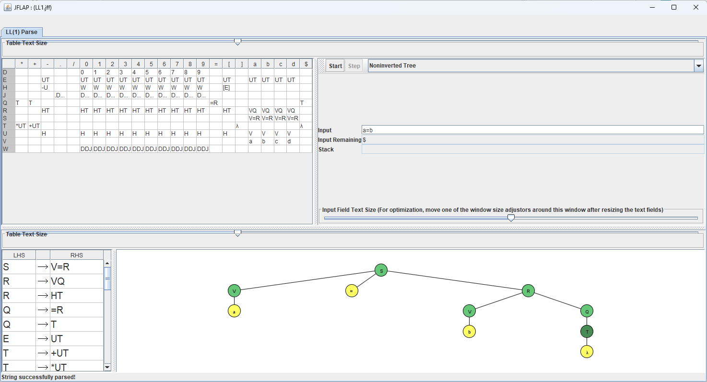

**Пример 2.** `b=-[a+12.04.2026]*c` — принята.

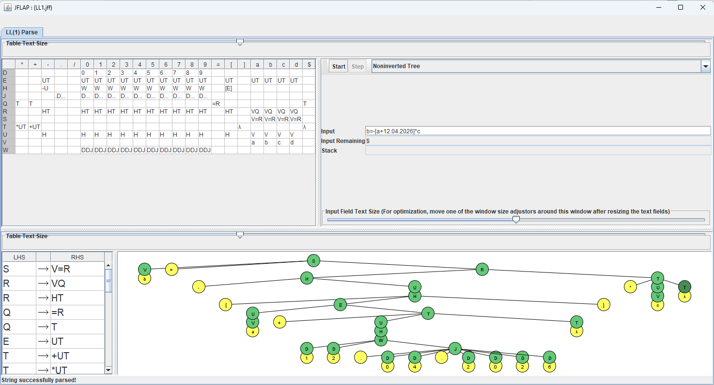

**Пример 3.** `d=c=2026/05/12` — принята.

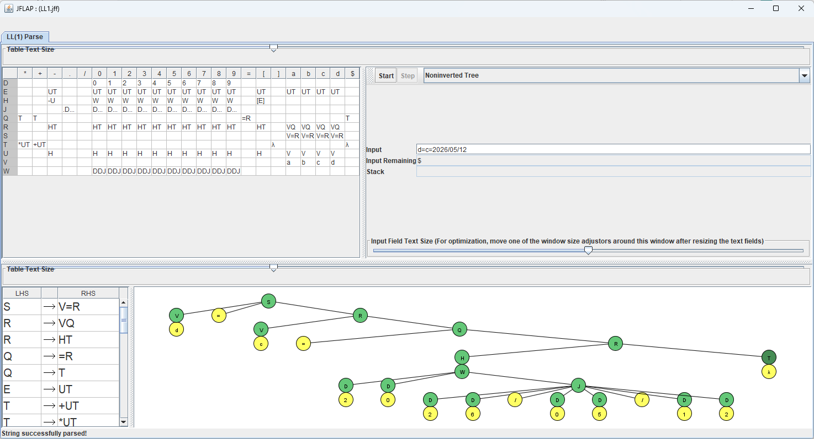

**Пример 4.** `a=123` — отклонена.

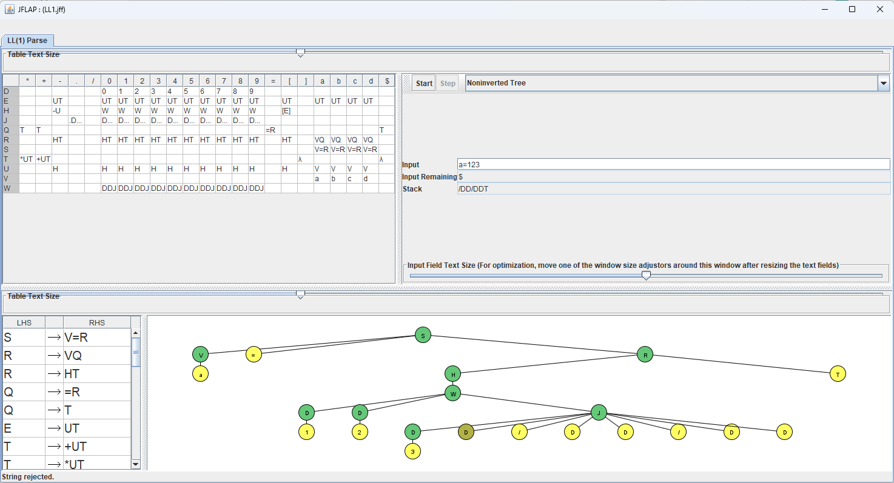

**Пример 5.** `a=12.04.26` — отклонена.

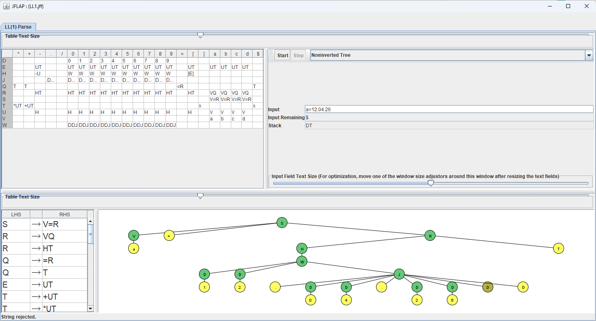

**Пример 6.** `a=[b+c` — отклонена.

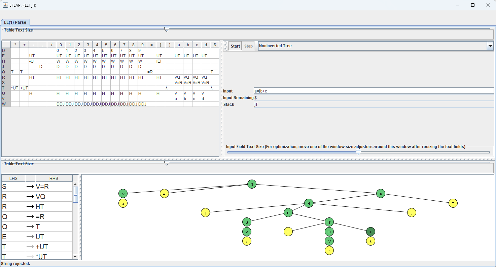

Модель [LL1_PDA.jff](LL1_PDA.jff) — магазинный автомат, построенный по той же грамматике. На входе в `q1` он кладёт начальный символ `S` над маркером дна `Z`. В `q1` переходы без чтения заменяют нетерминал на вершине правой частью соответствующей продукции. Переход с чтением снимает с вершины такой же терминальный символ. В `q2` автомат переходит при достижении `Z`. Цепочка принимается при полном чтении входа и достижении `q2`. Каждая принимающая ветвь воспроизводит левосторонний вывод. Те же шесть цепочек проверены в режиме **Input → Multiple Run** с критерием **Final State**.

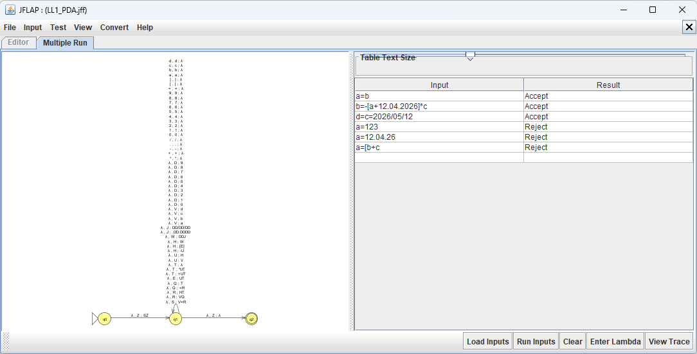

## 3 Часть 2. Анализатор методом рекурсивного спуска

### 3.1 Лексемы и грамматика

Исходный код — [parser.py](parser.py). Лексер выделяет `ID` по шаблону `[a-z]{1,2}`, `INT` по шаблону `[0-9]+` и `DATE` по двум форматам из раздела 1. При чтении идентификатора лексер проверяет длину всей непрерывной группы букв. Дата проверяется раньше целого числа, поскольку запись даты начинается с цифр. Знаки операций, скобки и разделитель образуют отдельные лексемы. `$` в грамматике соответствует токену `EOF` в программе.

```
S → E T
T → ; E T | ε
E → ID A | H B
A → = E | B
B → + U B | * U B | ε
U → ID | H
H → - U | ( E ) | DATE | INT
```

`S` разбирает первое выражение, а `T` — остальные выражения с разделителями. `E` после чтения `ID` передаёт управление `A`, который различает присваивание и обычное выражение. Благодаря `A → = E` правая часть присваивания может содержать ещё одно присваивание. `H` обрабатывает унарный минус, скобки и константы. `B` разбирает хвост бинарного выражения. После успешного разбора `S` программа проверяет конец ввода.

Рекурсивный вызов `expression()` обрабатывает вложенное выражение в скобках. Хвостовая рекурсия в последовательностях присваиваний, бинарных операций, унарных минусов и выражений через `;` реализована циклами.

### 3.2 Доказательство принадлежности грамматики к классу LL(1)

| Нетерминал | FIRST | FOLLOW |
| --- | --- | --- |
| `S` | `{ID, -, (, DATE, INT}` | `{$}` |
| `T` | `{;, ε}` | `{$}` |
| `E` | `{ID, -, (, DATE, INT}` | `{;, ), $}` |
| `A` | `{=, +, *, ε}` | `{;, ), $}` |
| `B` | `{+, *, ε}` | `{;, ), $}` |
| `U` | `{ID, -, (, DATE, INT}` | `{+, *, ;, ), $}` |
| `H` | `{-, (, DATE, INT}` | `{+, *, ;, ), $}` |

Обозначим через `SELECT(A → α)` множество `FIRST(α) \ {ε}`, дополненное `FOLLOW(A)` при `ε ∈ FIRST(α)`. Грамматика является LL(1), если для альтернатив каждого нетерминала множества `SELECT` попарно не пересекаются.

| Нетерминал | Множества SELECT в порядке записи альтернатив |
| --- | --- |
| `T` | `{;}`, `{$}` |
| `E` | `{ID}`, `{-, (, DATE, INT}` |
| `A` | `{=}`, `{+, *, ;, ), $}` |
| `B` | `{+}`, `{*}`, `{;, ), $}` |
| `U` | `{ID}`, `{-, (, DATE, INT}` |
| `H` | `{-}`, `{(}`, `{DATE}`, `{INT}` |

У `S` единственная продукция. В каждой строке таблицы множества выбора попарно не пересекаются, включая `SELECT(A → B)`, в которое входят символы `FOLLOW(A)`, поскольку `B ⇒ ε`. Значит, на любом шаге синтаксического анализа одной лексемы предпросмотра достаточно для выбора продукции. Грамматика принадлежит классу LL(1).

### 3.3 Запуск и тестирование

В каталоге работы выполните команду. При запуске без аргумента программа читает последовательность из стандартного ввода до конца файла.

```powershell
python parser.py "ab=12.04.2026; x=-(y+7)*z"
```

| № | Входная цепочка | Результат | Пояснение |
| --- | --- | --- | --- |
| 1 | `a` | `Accepted` | выражение из одной переменной |
| 2 | `007` | `Accepted` | десятичное целое с ведущими нулями |
| 3 | `12.04.2026+2026/05/12` | `Accepted` | оба формата даты в одном выражении |
| 4 | `ab=12.04.2026; x=-(y+7)*z` | `Accepted` | последовательность и имя из двух букв |
| 5 | `a=bc=2026/05/12` | `Accepted` | правоассоциативное присваивание |
| 6 | `(ab=42)+c` | `Accepted` | присваивание внутри скобок |
| 7 | `--x * 20 + yz` | `Accepted` | два унарных минуса и обе бинарные операции |
| 8 | пустая цепочка | `Rejected` | пустой ввод |
| 9 | `a;` | `Rejected` | разделитель в конце последовательности |
| 10 | `a;;b` | `Rejected` | пустое выражение между разделителями |
| 11 | `abc=1` | `Rejected` | имя состоит из трёх букв |
| 12 | `a+b=7` | `Rejected` | слева от присваивания стоит бинарное выражение |
| 13 | `a=12.04.26` | `Rejected` | год записан двумя цифрами |
| 14 | `a=2026/5/12` | `Rejected` | месяц записан одной цифрой |
| 15 | `a=-(b+2` | `Rejected` | отсутствует закрывающая скобка |
| 16 | `x+*4` | `Rejected` | между бинарными операциями отсутствует операнд |
| 17 | `ab=1@` | `Rejected` | посторонний символ после корректного префикса |

## 4 Часть 3. SLR(1)-грамматика

### 4.1 Построение грамматики

Модель JFLAP — [SLR1.jff](SLR1.jff). Начальный символ — `S`. Для построения канонического автомата добавлено правило `0. S′ → S`. Номера остальных правил совпадают с номерами свёрток в таблице.

```
 0. S′ → S
 1. S → S;A
 2. S → A
 3. A → V=E
 4. A → V=A
 5. E → E+U
 6. E → E*U
 7. E → U
 8. U → -U
 9. U → F
10. F → [E]
11. F → V
12. F → C
13. C → D
14. C → P
15. C → PD
16. C → PP
17. C → PPN
18. C → P.P.PP
19. C → PP/P/P
20. N → DN
21. N → D
22. P → DD
23. V → a
24. V → b
25. V → c
26. V → d
27. D → 0
28. D → 1
29. D → 2
30. D → 3
31. D → 4
32. D → 5
33. D → 6
34. D → 7
35. D → 8
36. D → 9
```

`S` порождает непустую последовательность присваиваний. `A` порождает присваивание, а `V` — имя допустимой переменной. Правило `A → V=A` позволяет разбирать цепочку присваиваний справа налево. Левая рекурсия в `E → E+U | E*U` задаёт один приоритет и левую ассоциативность для обоих бинарных операторов. `U → -U` задаёт более высокий приоритет унарного минуса.

`D` порождает одну цифру, `P` — пару цифр, `N` — одну или несколько цифр. В `C` альтернативы `D`, `P`, `PD`, `PP`, `PPN` представляют целые длины 1, 2, 3, 4 и от 5 соответственно. Правила `C → P.P.PP` и `C → PP/P/P` порождают даты двух форматов. Такое построение использует одинаковые префиксы из цифр для числа и даты.

### 4.2 Множества FIRST и FOLLOW

| Нетерминал | FIRST | FOLLOW |
| --- | --- | --- |
| `S′` | `{var}` | `{$}` |
| `S` | `{var}` | `{;, $}` |
| `A` | `{var}` | `{;, $}` |
| `E` | `{-, [, digit, var}` | `{*, +, ;, ], $}` |
| `U` | `{-, [, digit, var}` | `{*, +, ;, ], $}` |
| `F` | `{[, digit, var}` | `{*, +, ;, ], $}` |
| `C` | `{digit}` | `{*, +, ;, ], $}` |
| `N` | `{digit}` | `{*, +, ;, ], $}` |
| `P` | `{digit}` | `{*, +, ., /, ;, ], digit, $}` |
| `V` | `{var}` | `{*, +, ;, =, ], $}` |
| `D` | `{digit}` | `{*, +, ., /, ;, ], digit, $}` |

### 4.3 Канонический набор LR(0)-ситуаций

`I₀ = CLOSURE({S′ → ·S})`. Операция `CLOSURE` добавляет ситуации с точкой в начале правой части для каждого нетерминала непосредственно после точки. Для каждого состояния `I` и каждого символа `X` после точки строится `GOTO(I, X)`. Точка переносится через `X`, затем берётся замыкание. Состояния пронумерованы в порядке обхода в ширину, символы переходов отсортированы по коду.

Всего состояний — 55.

| Состояние | LR(0)-ситуации |
| --- | --- |
| `I0` | `S′ → ·S`, `S → ·S;A`, `S → ·A`, `A → ·V=E`, `A → ·V=A`, `V → ·a`, `V → ·b`, `V → ·c`, `V → ·d` |
| `I1` | `S → A·` |
| `I2` | `S′ → S·`, `S → S·;A` |
| `I3` | `A → V·=E`, `A → V·=A` |
| `I4` | `V → a·` |
| `I5` | `V → b·` |
| `I6` | `V → c·` |
| `I7` | `V → d·` |
| `I8` | `S → S;·A`, `A → ·V=E`, `A → ·V=A`, `V → ·a`, `V → ·b`, `V → ·c`, `V → ·d` |
| `I9` | `A → ·V=E`, `A → V=·E`, `A → ·V=A`, `A → V=·A`, `E → ·E+U`, `E → ·E*U`, `E → ·U`, `U → ·-U`, `U → ·F`, `F → ·[E]`, `F → ·V`, `F → ·C`, `C → ·D`, `C → ·P`, `C → ·PD`, `C → ·PP`, `C → ·PPN`, `C → ·P.P.PP`, `C → ·PP/P/P`, `P → ·DD`, `V → ·a`, `V → ·b`, `V → ·c`, `V → ·d`, `D → ·0`, `D → ·1`, `D → ·2`, `D → ·3`, `D → ·4`, `D → ·5`, `D → ·6`, `D → ·7`, `D → ·8`, `D → ·9` |
| `I10` | `S → S;A·` |
| `I11` | `U → ·-U`, `U → -·U`, `U → ·F`, `F → ·[E]`, `F → ·V`, `F → ·C`, `C → ·D`, `C → ·P`, `C → ·PD`, `C → ·PP`, `C → ·PPN`, `C → ·P.P.PP`, `C → ·PP/P/P`, `P → ·DD`, `V → ·a`, `V → ·b`, `V → ·c`, `V → ·d`, `D → ·0`, `D → ·1`, `D → ·2`, `D → ·3`, `D → ·4`, `D → ·5`, `D → ·6`, `D → ·7`, `D → ·8`, `D → ·9` |
| `I12` | `D → 0·` |
| `I13` | `D → 1·` |
| `I14` | `D → 2·` |
| `I15` | `D → 3·` |
| `I16` | `D → 4·` |
| `I17` | `D → 5·` |
| `I18` | `D → 6·` |
| `I19` | `D → 7·` |
| `I20` | `D → 8·` |
| `I21` | `D → 9·` |
| `I22` | `A → V=A·` |
| `I23` | `F → C·` |
| `I24` | `C → D·`, `P → D·D`, `D → ·0`, `D → ·1`, `D → ·2`, `D → ·3`, `D → ·4`, `D → ·5`, `D → ·6`, `D → ·7`, `D → ·8`, `D → ·9` |
| `I25` | `A → V=E·`, `E → E·+U`, `E → E·*U` |
| `I26` | `U → F·` |
| `I27` | `C → P·`, `C → P·D`, `C → P·P`, `C → P·PN`, `C → P·.P.PP`, `C → P·P/P/P`, `P → ·DD`, `D → ·0`, `D → ·1`, `D → ·2`, `D → ·3`, `D → ·4`, `D → ·5`, `D → ·6`, `D → ·7`, `D → ·8`, `D → ·9` |
| `I28` | `E → U·` |
| `I29` | `A → V·=E`, `A → V·=A`, `F → V·` |
| `I30` | `E → ·E+U`, `E → ·E*U`, `E → ·U`, `U → ·-U`, `U → ·F`, `F → ·[E]`, `F → [·E]`, `F → ·V`, `F → ·C`, `C → ·D`, `C → ·P`, `C → ·PD`, `C → ·PP`, `C → ·PPN`, `C → ·P.P.PP`, `C → ·PP/P/P`, `P → ·DD`, `V → ·a`, `V → ·b`, `V → ·c`, `V → ·d`, `D → ·0`, `D → ·1`, `D → ·2`, `D → ·3`, `D → ·4`, `D → ·5`, `D → ·6`, `D → ·7`, `D → ·8`, `D → ·9` |
| `I31` | `U → -U·` |
| `I32` | `F → V·` |
| `I33` | `P → DD·` |
| `I34` | `E → E*·U`, `U → ·-U`, `U → ·F`, `F → ·[E]`, `F → ·V`, `F → ·C`, `C → ·D`, `C → ·P`, `C → ·PD`, `C → ·PP`, `C → ·PPN`, `C → ·P.P.PP`, `C → ·PP/P/P`, `P → ·DD`, `V → ·a`, `V → ·b`, `V → ·c`, `V → ·d`, `D → ·0`, `D → ·1`, `D → ·2`, `D → ·3`, `D → ·4`, `D → ·5`, `D → ·6`, `D → ·7`, `D → ·8`, `D → ·9` |
| `I35` | `E → E+·U`, `U → ·-U`, `U → ·F`, `F → ·[E]`, `F → ·V`, `F → ·C`, `C → ·D`, `C → ·P`, `C → ·PD`, `C → ·PP`, `C → ·PPN`, `C → ·P.P.PP`, `C → ·PP/P/P`, `P → ·DD`, `V → ·a`, `V → ·b`, `V → ·c`, `V → ·d`, `D → ·0`, `D → ·1`, `D → ·2`, `D → ·3`, `D → ·4`, `D → ·5`, `D → ·6`, `D → ·7`, `D → ·8`, `D → ·9` |
| `I36` | `C → P.·P.PP`, `P → ·DD`, `D → ·0`, `D → ·1`, `D → ·2`, `D → ·3`, `D → ·4`, `D → ·5`, `D → ·6`, `D → ·7`, `D → ·8`, `D → ·9` |
| `I37` | `C → PD·`, `P → D·D`, `D → ·0`, `D → ·1`, `D → ·2`, `D → ·3`, `D → ·4`, `D → ·5`, `D → ·6`, `D → ·7`, `D → ·8`, `D → ·9` |
| `I38` | `C → PP·`, `C → PP·N`, `C → PP·/P/P`, `N → ·DN`, `N → ·D`, `D → ·0`, `D → ·1`, `D → ·2`, `D → ·3`, `D → ·4`, `D → ·5`, `D → ·6`, `D → ·7`, `D → ·8`, `D → ·9` |
| `I39` | `E → E·+U`, `E → E·*U`, `F → [E·]` |
| `I40` | `E → E*U·` |
| `I41` | `E → E+U·` |
| `I42` | `P → D·D`, `D → ·0`, `D → ·1`, `D → ·2`, `D → ·3`, `D → ·4`, `D → ·5`, `D → ·6`, `D → ·7`, `D → ·8`, `D → ·9` |
| `I43` | `C → P.P·.PP` |
| `I44` | `C → PP/·P/P`, `P → ·DD`, `D → ·0`, `D → ·1`, `D → ·2`, `D → ·3`, `D → ·4`, `D → ·5`, `D → ·6`, `D → ·7`, `D → ·8`, `D → ·9` |
| `I45` | `N → ·DN`, `N → D·N`, `N → ·D`, `N → D·`, `D → ·0`, `D → ·1`, `D → ·2`, `D → ·3`, `D → ·4`, `D → ·5`, `D → ·6`, `D → ·7`, `D → ·8`, `D → ·9` |
| `I46` | `C → PPN·` |
| `I47` | `F → [E]·` |
| `I48` | `C → P.P.·PP`, `P → ·DD`, `D → ·0`, `D → ·1`, `D → ·2`, `D → ·3`, `D → ·4`, `D → ·5`, `D → ·6`, `D → ·7`, `D → ·8`, `D → ·9` |
| `I49` | `C → PP/P·/P` |
| `I50` | `N → DN·` |
| `I51` | `C → P.P.P·P`, `P → ·DD`, `D → ·0`, `D → ·1`, `D → ·2`, `D → ·3`, `D → ·4`, `D → ·5`, `D → ·6`, `D → ·7`, `D → ·8`, `D → ·9` |
| `I52` | `C → PP/P/·P`, `P → ·DD`, `D → ·0`, `D → ·1`, `D → ·2`, `D → ·3`, `D → ·4`, `D → ·5`, `D → ·6`, `D → ·7`, `D → ·8`, `D → ·9` |
| `I53` | `C → P.P.PP·` |
| `I54` | `C → PP/P/P·` |

### 4.4 Таблица синтаксического анализа

`sN` означает сдвиг в состояние `N`, `rK` — свёртку по правилу `K`, `acc` — принятие. В части GOTO показаны номера состояний после перехода по нетерминалу. Прочерк означает пустую ячейку. Диапазон `sM…sN` в столбце `digit` разворачивается в десять действий для `0…9`, в столбце `var` — в четыре действия для `a…d`. Одиночное значение в групповом столбце относится ко всем символам группы.

#### ACTION

| Состояние | `var` | `digit` | `=` | `-` | `+` | `*` | `[` | `]` | `.` | `/` | `;` | `$` |
| --- | --- | --- | --- | --- | --- | --- | --- | --- | --- | --- | --- | --- |
| 0 | `s4…s7` | — | — | — | — | — | — | — | — | — | — | — |
| 1 | — | — | — | — | — | — | — | — | — | — | `r2` | `r2` |
| 2 | — | — | — | — | — | — | — | — | — | — | `s8` | `acc` |
| 3 | — | — | `s9` | — | — | — | — | — | — | — | — | — |
| 4 | — | — | `r23` | — | `r23` | `r23` | — | `r23` | — | — | `r23` | `r23` |
| 5 | — | — | `r24` | — | `r24` | `r24` | — | `r24` | — | — | `r24` | `r24` |
| 6 | — | — | `r25` | — | `r25` | `r25` | — | `r25` | — | — | `r25` | `r25` |
| 7 | — | — | `r26` | — | `r26` | `r26` | — | `r26` | — | — | `r26` | `r26` |
| 8 | `s4…s7` | — | — | — | — | — | — | — | — | — | — | — |
| 9 | `s4…s7` | `s12…s21` | — | `s11` | — | — | `s30` | — | — | — | — | — |
| 10 | — | — | — | — | — | — | — | — | — | — | `r1` | `r1` |
| 11 | `s4…s7` | `s12…s21` | — | `s11` | — | — | `s30` | — | — | — | — | — |
| 12 | — | `r27` | — | — | `r27` | `r27` | — | `r27` | `r27` | `r27` | `r27` | `r27` |
| 13 | — | `r28` | — | — | `r28` | `r28` | — | `r28` | `r28` | `r28` | `r28` | `r28` |
| 14 | — | `r29` | — | — | `r29` | `r29` | — | `r29` | `r29` | `r29` | `r29` | `r29` |
| 15 | — | `r30` | — | — | `r30` | `r30` | — | `r30` | `r30` | `r30` | `r30` | `r30` |
| 16 | — | `r31` | — | — | `r31` | `r31` | — | `r31` | `r31` | `r31` | `r31` | `r31` |
| 17 | — | `r32` | — | — | `r32` | `r32` | — | `r32` | `r32` | `r32` | `r32` | `r32` |
| 18 | — | `r33` | — | — | `r33` | `r33` | — | `r33` | `r33` | `r33` | `r33` | `r33` |
| 19 | — | `r34` | — | — | `r34` | `r34` | — | `r34` | `r34` | `r34` | `r34` | `r34` |
| 20 | — | `r35` | — | — | `r35` | `r35` | — | `r35` | `r35` | `r35` | `r35` | `r35` |
| 21 | — | `r36` | — | — | `r36` | `r36` | — | `r36` | `r36` | `r36` | `r36` | `r36` |
| 22 | — | — | — | — | — | — | — | — | — | — | `r4` | `r4` |
| 23 | — | — | — | — | `r12` | `r12` | — | `r12` | — | — | `r12` | `r12` |
| 24 | — | `s12…s21` | — | — | `r13` | `r13` | — | `r13` | — | — | `r13` | `r13` |
| 25 | — | — | — | — | `s35` | `s34` | — | — | — | — | `r3` | `r3` |
| 26 | — | — | — | — | `r9` | `r9` | — | `r9` | — | — | `r9` | `r9` |
| 27 | — | `s12…s21` | — | — | `r14` | `r14` | — | `r14` | `s36` | — | `r14` | `r14` |
| 28 | — | — | — | — | `r7` | `r7` | — | `r7` | — | — | `r7` | `r7` |
| 29 | — | — | `s9` | — | `r11` | `r11` | — | `r11` | — | — | `r11` | `r11` |
| 30 | `s4…s7` | `s12…s21` | — | `s11` | — | — | `s30` | — | — | — | — | — |
| 31 | — | — | — | — | `r8` | `r8` | — | `r8` | — | — | `r8` | `r8` |
| 32 | — | — | — | — | `r11` | `r11` | — | `r11` | — | — | `r11` | `r11` |
| 33 | — | `r22` | — | — | `r22` | `r22` | — | `r22` | `r22` | `r22` | `r22` | `r22` |
| 34 | `s4…s7` | `s12…s21` | — | `s11` | — | — | `s30` | — | — | — | — | — |
| 35 | `s4…s7` | `s12…s21` | — | `s11` | — | — | `s30` | — | — | — | — | — |
| 36 | — | `s12…s21` | — | — | — | — | — | — | — | — | — | — |
| 37 | — | `s12…s21` | — | — | `r15` | `r15` | — | `r15` | — | — | `r15` | `r15` |
| 38 | — | `s12…s21` | — | — | `r16` | `r16` | — | `r16` | — | `s44` | `r16` | `r16` |
| 39 | — | — | — | — | `s35` | `s34` | — | `s47` | — | — | — | — |
| 40 | — | — | — | — | `r6` | `r6` | — | `r6` | — | — | `r6` | `r6` |
| 41 | — | — | — | — | `r5` | `r5` | — | `r5` | — | — | `r5` | `r5` |
| 42 | — | `s12…s21` | — | — | — | — | — | — | — | — | — | — |
| 43 | — | — | — | — | — | — | — | — | `s48` | — | — | — |
| 44 | — | `s12…s21` | — | — | — | — | — | — | — | — | — | — |
| 45 | — | `s12…s21` | — | — | `r21` | `r21` | — | `r21` | — | — | `r21` | `r21` |
| 46 | — | — | — | — | `r17` | `r17` | — | `r17` | — | — | `r17` | `r17` |
| 47 | — | — | — | — | `r10` | `r10` | — | `r10` | — | — | `r10` | `r10` |
| 48 | — | `s12…s21` | — | — | — | — | — | — | — | — | — | — |
| 49 | — | — | — | — | — | — | — | — | — | `s52` | — | — |
| 50 | — | — | — | — | `r20` | `r20` | — | `r20` | — | — | `r20` | `r20` |
| 51 | — | `s12…s21` | — | — | — | — | — | — | — | — | — | — |
| 52 | — | `s12…s21` | — | — | — | — | — | — | — | — | — | — |
| 53 | — | — | — | — | `r18` | `r18` | — | `r18` | — | — | `r18` | `r18` |
| 54 | — | — | — | — | `r19` | `r19` | — | `r19` | — | — | `r19` | `r19` |

#### GOTO

| Состояние | `S` | `A` | `E` | `U` | `F` | `C` | `N` | `P` | `V` | `D` |
| --- | --- | --- | --- | --- | --- | --- | --- | --- | --- | --- |
| 0 | `2` | `1` | — | — | — | — | — | — | `3` | — |
| 1 | — | — | — | — | — | — | — | — | — | — |
| 2 | — | — | — | — | — | — | — | — | — | — |
| 3 | — | — | — | — | — | — | — | — | — | — |
| 4 | — | — | — | — | — | — | — | — | — | — |
| 5 | — | — | — | — | — | — | — | — | — | — |
| 6 | — | — | — | — | — | — | — | — | — | — |
| 7 | — | — | — | — | — | — | — | — | — | — |
| 8 | — | `10` | — | — | — | — | — | — | `3` | — |
| 9 | — | `22` | `25` | `28` | `26` | `23` | — | `27` | `29` | `24` |
| 10 | — | — | — | — | — | — | — | — | — | — |
| 11 | — | — | — | `31` | `26` | `23` | — | `27` | `32` | `24` |
| 12 | — | — | — | — | — | — | — | — | — | — |
| 13 | — | — | — | — | — | — | — | — | — | — |
| 14 | — | — | — | — | — | — | — | — | — | — |
| 15 | — | — | — | — | — | — | — | — | — | — |
| 16 | — | — | — | — | — | — | — | — | — | — |
| 17 | — | — | — | — | — | — | — | — | — | — |
| 18 | — | — | — | — | — | — | — | — | — | — |
| 19 | — | — | — | — | — | — | — | — | — | — |
| 20 | — | — | — | — | — | — | — | — | — | — |
| 21 | — | — | — | — | — | — | — | — | — | — |
| 22 | — | — | — | — | — | — | — | — | — | — |
| 23 | — | — | — | — | — | — | — | — | — | — |
| 24 | — | — | — | — | — | — | — | — | — | `33` |
| 25 | — | — | — | — | — | — | — | — | — | — |
| 26 | — | — | — | — | — | — | — | — | — | — |
| 27 | — | — | — | — | — | — | — | `38` | — | `37` |
| 28 | — | — | — | — | — | — | — | — | — | — |
| 29 | — | — | — | — | — | — | — | — | — | — |
| 30 | — | — | `39` | `28` | `26` | `23` | — | `27` | `32` | `24` |
| 31 | — | — | — | — | — | — | — | — | — | — |
| 32 | — | — | — | — | — | — | — | — | — | — |
| 33 | — | — | — | — | — | — | — | — | — | — |
| 34 | — | — | — | `40` | `26` | `23` | — | `27` | `32` | `24` |
| 35 | — | — | — | `41` | `26` | `23` | — | `27` | `32` | `24` |
| 36 | — | — | — | — | — | — | — | `43` | — | `42` |
| 37 | — | — | — | — | — | — | — | — | — | `33` |
| 38 | — | — | — | — | — | — | `46` | — | — | `45` |
| 39 | — | — | — | — | — | — | — | — | — | — |
| 40 | — | — | — | — | — | — | — | — | — | — |
| 41 | — | — | — | — | — | — | — | — | — | — |
| 42 | — | — | — | — | — | — | — | — | — | `33` |
| 43 | — | — | — | — | — | — | — | — | — | — |
| 44 | — | — | — | — | — | — | — | `49` | — | `42` |
| 45 | — | — | — | — | — | — | `50` | — | — | `45` |
| 46 | — | — | — | — | — | — | — | — | — | — |
| 47 | — | — | — | — | — | — | — | — | — | — |
| 48 | — | — | — | — | — | — | — | `51` | — | `42` |
| 49 | — | — | — | — | — | — | — | — | — | — |
| 50 | — | — | — | — | — | — | — | — | — | — |
| 51 | — | — | — | — | — | — | — | `53` | — | `42` |
| 52 | — | — | — | — | — | — | — | `54` | — | `42` |
| 53 | — | — | — | — | — | — | — | — | — | — |
| 54 | — | — | — | — | — | — | — | — | — | — |

Например, в `I₂` ситуация `S → S·;A` задаёт сдвиг на `;`, а `S′ → S·` — принятие на `$`. В `I₂₅` завершённая ситуация `A → V=E·` задаёт `r3` на `FOLLOW(A) = {;, $}`. Сдвиги из `I₂₅` выполняются на `+` и `*`, поэтому со свёрткой они не конфликтуют. В полной таблице каждая ячейка ACTION имеет максимум одно действие. Конфликтов сдвиг/свёртка и свёртка/свёртка нет, следовательно, грамматика принадлежит классу SLR(1).

### 4.5 Проверка таблично-управляемого алгоритма

Для `SLR1.jff` в JFLAP построена таблица через **Input → Build SLR(1) Parse Table**. Кнопка **Do All** достраивает множества, автомат и таблицу. В режиме **Parse** каждая цепочка проверена командами **Start** и **Step** до принятия или отклонения. При заполнении таблицы в интерфейсе номера состояний могут отличаться, поскольку они зависят от порядка построения автомата.

| № | Входная цепочка | Результат | Пояснение |
| --- | --- | --- | --- |
| 1 | `a=42` | `принята` | присваивание целого числа |
| 2 | `a=12.04.2026;b=-[c+2026/05/12]*d` | `принята` | два присваивания, оба формата даты и скобки |
| 3 | `d=c=00012` | `принята` | цепочка присваиваний и целое длиной больше четырёх |
| 4 | `a=42;` | `отклонена` | после разделителя требуется присваивание |
| 5 | `1=a` | `отклонена` | слева требуется имя переменной |
| 6 | `a=2026/5/12` | `отклонена` | месяц должен состоять из двух цифр |

**Пример 1.** `a=42` — принята.

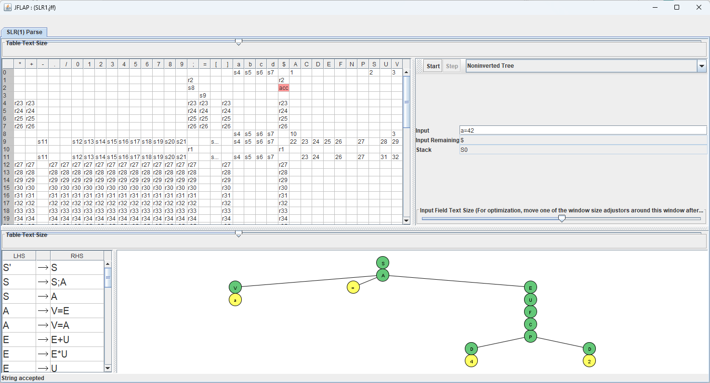

**Пример 2.** `a=12.04.2026;b=-[c+2026/05/12]*d` — принята.

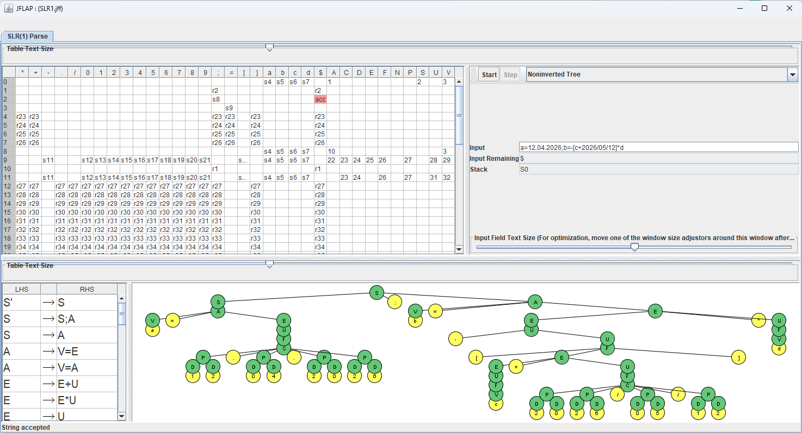

**Пример 3.** `d=c=00012` — принята.

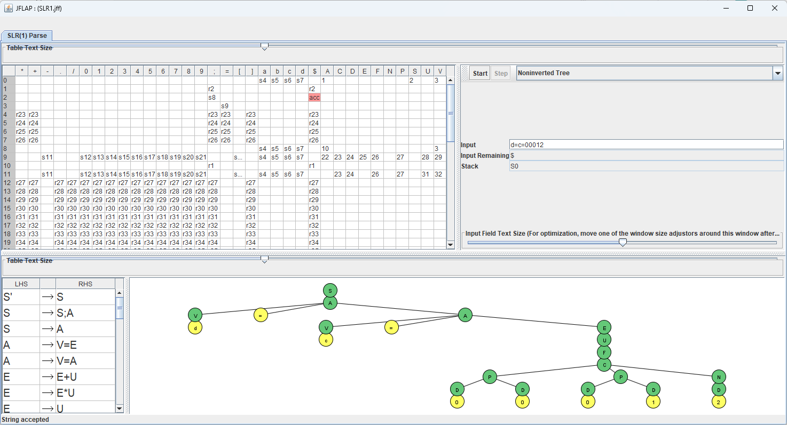

**Пример 4.** `a=42;` — отклонена.

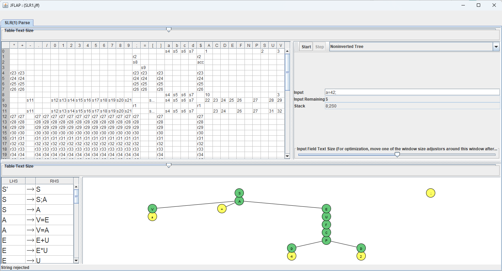

**Пример 5.** `1=a` — отклонена.

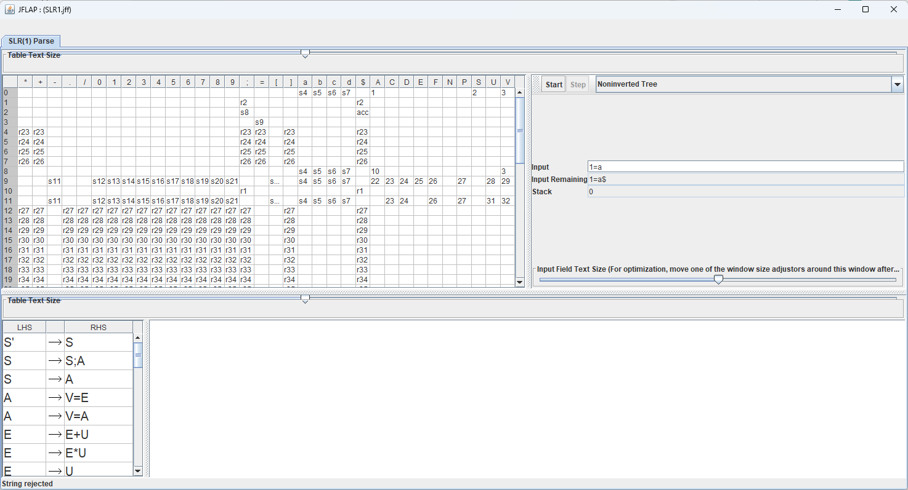

**Пример 6.** `a=2026/5/12` — отклонена.

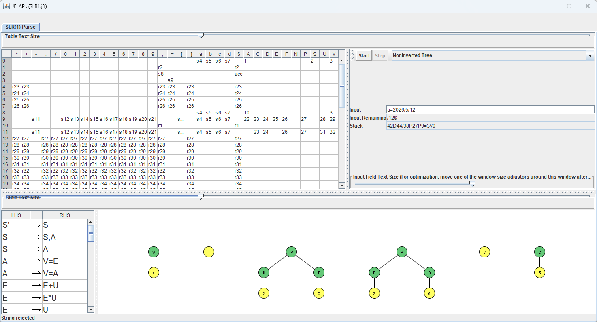

## 5 Заключение

В JFLAP построены две грамматики для варианта № 7. Для первой получена бесконфликтная таблица LL(1) и построен магазинный автомат. Для третьей построен канонический набор из 55 состояний LR(0) и получена бесконфликтная таблица SLR(1). В обоих режимах JFLAP проверено по шесть цепочек. Для второго языка реализован анализатор методом рекурсивного спуска, доказано свойство LL(1) его токенной грамматики и проверено 17 тестовых примеров.
